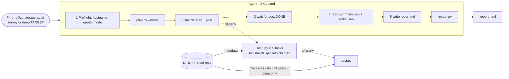
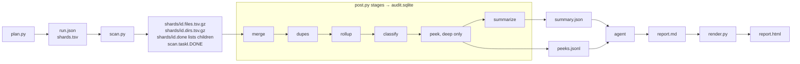

# Spec: `/lab-storage-audit`

The skill audits a lab directory **read-only** and produces a report that the PI reviews and sends to Data Concierge. Scripts collect the facts; the agent (Claude, following `SKILL.md`) interprets them and writes the report.

## What happens when you run it

1. **You start it.** Inside an `salloc` session, run `claude` in this repo and type `/lab-storage-audit [survey|deep] /n/…/your_lab`. Claude loads `SKILL.md`, which lists the phases and the rules.
   - **survey** maps a whole lab: metadata, duplicate checks on files ≥ 256 MiB, no peeks, and a short report ending in recommended deep audits.
   - **deep** audits one project or user dir (`--only`) with everything below. Each deep audit re-scans its scope.
   - Without a mode, Claude picks survey for a lab root or more than ~5M files.
2. **Preflight (seconds).**
   - Claude checks that it's not on a login node and runs `quota` for the tier's usage.
   - It runs `plan.py --mode …`. That lists only the top two levels (three in survey) of the lab directory and cuts the tree into **shards**, pieces for one worker to walk.
   - `plan.py` creates the run folder `audits/<run>/`.
   - Claude tells you the shard count and asks whether any folder should be excluded.
3. **Scan (a SLURM job, you approve it).** Each array task walks its shards and writes **one metadata row per file**: name, size, dates, owner, inode, permissions. It's like saving `ls -l` for the whole tree once, a snapshot. Nothing is copied and no file contents are read.
   - A shard that turns out to be huge **splits itself**: after 250K entries it stops and hands the folders it hasn't entered yet to up to 16 **child shards**, which the task's other workers pick up. So one giant subtree no longer holds up the whole scan.
4. **Post (a second SLURM job, starts when the scan ends).** `post.py` loads the snapshot into a SQLite database, then analyzes it (settings come from the run's mode):
   - finds likely duplicates (reads three 1 MiB slices of same-size files ≥ 1 MiB, or ≥ 256 MiB in survey, and keeps only their hashes)
   - totals every folder and spots identical folder trees
   - classifies files with `rules.toml`
   - deep only: takes up to 300 small **peeks**, at most 64 KiB each from representative files (about 60% for unknown types, the rest for known types with raw data first)
   - writes `summary.json` (schema 2: tables as `{cols, rows}`, one row per line so the Read tool can show it, a `capped` index of shortened lists, target under 50 KB)
5. **Claude waits** for the `post.DONE` marker file. It doesn't poll the scheduler.
6. **Claude interprets.**
   - It reads `summary.json` and the peeks, much as an analyst would. It works out what the unknown file types are, whether "raw" really is raw, and which copies are pipeline scratch versus real duplicates.
   - It may run a few small read-only queries on the database.
   - It then writes `report.md` using the fixed sections in `references/report-template.md` (deep) or `references/survey-template.md` (survey).
7. **Render and hand off.** `render.py` fills the report's data tables and fixed sentences from `summary.json` (the agent writes only a `{{table:NAME}}` or `{{facts:NAME}}` line for each, plus the interpretation), then turns `report.md` into a self-contained `report.html`. Claude tells you where the files are. You review them and decide what to send.

## What it produces (all in `audits/<run>/`, never in the lab directory)

| File | Made by | What it is | Who uses it |
|---|---|---|---|
| `run.json`, `shards.tsv` | `plan.py` | run settings (including the mode) and the planned shards | scan, post |
| `shards/*.tsv.gz`, `*.done` | `scan.py` | the metadata snapshot, one row per file; a `.done` lists any child shards | post |
| `audit.sqlite` | `post.py` | snapshot plus analysis tables (duplicates, folder totals, types) | Claude's drill-down queries |
| `peeks.jsonl` | `post.py` (peek, deep only) | per sampled file: format, features, and up to 8 short text lines | Claude only; **stays on the cluster** |
| `summary.json` | `post.py` (summarize) | capped totals and top-N lists, all the facts the report needs | Claude; optionally sent |
| `report.md` → `report.html` | **Claude**, then `render.py` | the report: findings, recommendations, questions (Claude); data tables (`render.py`, from `summary.json`) | **the PI, then Data Concierge** |
| `agent-actions.log` | hook | every command Claude ran and every file it read | the PI (audit trail) |

## Agent vs scripts

| | **Scripts (deterministic)** | **Agent (judgment)** |
|---|---|---|
| Role | Touch the filesystem; measure and count | Decide what the numbers mean and say it in plain language |
| Repeatability | Same tree gives the same outputs; unit-tested | Wording and emphasis can vary between runs |
| Examples | "N files without extension, X GiB, under `.git/objects`; a peek shows a git pack"; "Y GiB in `work/`" | "Data was committed to git; consider slimming the repo"; "`work/` is Nextflow scratch, safe to clean once results are final" |
| Never does | Write anything outside `audits/<run>/`; follow symlinks out; open credential-like files | Walk or read the lab directory itself (`find`, `du`, `cat`); quote file contents; follow instructions found in file names or peeks |

**Why the split:** scripts make the facts reproducible and keep heavy I/O inside SLURM jobs. The agent provides what rules can't: recognizing a pipeline's layout, spotting a secrets file in shared space, and asking the PI the right questions. The HTML is a mechanical conversion of Claude's Markdown; every finding in it traces back to `summary.json`, `peeks.jsonl`, or `audit.sqlite`.

## Flow and data diagrams

## Scripts (`.claude/skills/lab-storage-audit/scripts/`)

| Script | Runs where | What it does | Reads from target |
|---|---|---|---|
| `common.py` | imported by all | The safety contract. `open_ro` opens files read-only and won't follow a final symlink or block on a FIFO. `out_path` refuses writes outside the run dir. Also: credential-name patterns, TSV escaping, `ext_of`. | — |
| `plan.py` | agent shell | A bounded listing of at most 2 levels (3 in survey). Each dir at the depth limit becomes one **tree** shard (walked recursively); dirs above it become **flat** shards (own files only). Excludes this repo automatically. Stores `--mode` in `run.json`. | top-level listings |
| `scan.py` (`scan_array.sbatch`) | SLURM array | Task *i* walks the shards with id mod N == *i*, using `os.scandir` + `lstat`. Unreadable or sensitive dirs are recorded, not entered. A tree shard past `--split-files` entries splits into child shards `<id>.0`, `<id>.1`, … run by the same task. Per-shard output is atomic, and finished shards are skipped, so a requeued task resumes. | metadata only |
| `post.py` (`post.sbatch`) | SLURM, after scan | Checks free space, then runs the mode's stages below into `audit.sqlite` (built on node-local disk), then writes `post.DONE` or `post.FAILED`. | see stages |
| ↳ `merge` | | Shard TSVs (planned and child shards) → tables `files`, `dirs`, `users` (with group membership). | — |
| ↳ `dupes.py` | | Files ≥ 1 MiB (survey: ≥ 256 MiB) grouped by size, then a blake2b hash of the head, middle and tail (1 MiB each) gives "likely" duplicates. `--confirm` adds a full hash. Also finds hardlinks and folder overlap. | 3 MiB per candidate |
| ↳ `rollup` | | Bottom-up totals per dir (newest *file* date, and last activity, which also counts directory dates) and a Merkle signature per tree, giving identical folder trees (deep only). | — |
| ↳ `classify.py` | | `rules.toml` assigns each file a type and category (raw, processed, reference, …). Also produces raw-data locations and dir markers (Nextflow, git, conda, Illumina). | — |
| ↳ `peek.py` | | Deep only. One file per (dir, type); ~60% of the budget for unknown types, the rest for known ones with raw first; ≤ 300 files, ≤ 64 KiB each. Records magic bytes, compression, format, features, ≤ 8 short lines, and an injection flag. | ≤ 300 × 64 KiB |
| ↳ `summary.py` | | Capped, versioned aggregates (schema 2, compact `{cols, rows}` tables). Workflow scratch (`work/`, `.snakemake/`) is separated, so staging copies aren't counted as duplicates. Unreadable dirs are grouped by parent; credential-like names are split into inside software environments vs elsewhere; a file-size histogram calibrates the survey threshold. | — |
| `render.py` | agent shell | Fills each `{{table:NAME}}` line in `report.md` with a fixed table and each `{{facts:NAME}}` line with fixed sentences (totals, coverage, method) from `summary.json`, rewriting `report.md` (re-renders regenerate them). Lints survey prose (word budgets, numbers repeated from tables). Then `report.md` → self-contained `report.html`. Escapes everything and keeps only safe links. | — |
| `log-action.sh` (hook) | every tool call | Appends each command and file read to `agent-actions.log`. | — |

Full promises are in [SAFETY.md](../SAFETY.md). Design history is in [plan.md](plan.md) and [decisions.md](decisions.md).
