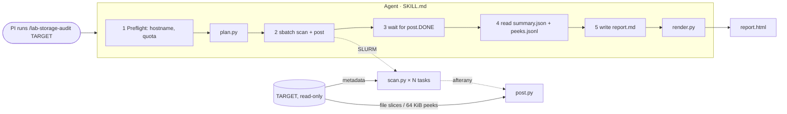
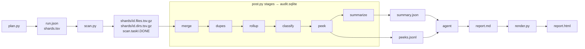

# Spec: `/lab-storage-audit`

The skill audits a lab directory **read-only** and produces a report that the PI reviews and sends to Data Concierge. Scripts collect the facts; the agent (Claude, following `SKILL.md`) interprets them and writes the report.

## What happens when you run it

1. **You start it.** Inside an `salloc` session, run `claude` in this repo and type `/lab-storage-audit /n/…/your_lab`. Claude loads `SKILL.md`, which lists the phases and the rules.
2. **Preflight (seconds).**
   - Claude checks that it's not on a login node and runs `quota` for the tier's usage.
   - It runs `plan.py`. That lists only the top two levels of the lab directory and cuts the tree into **shards**, pieces small enough for one worker to walk.
   - `plan.py` creates the run folder `audits/<run>/`.
   - Claude tells you the shard count and asks whether any folder should be excluded.
3. **Scan (a SLURM job, you approve it).** Each array task walks its shards and writes **one metadata row per file**: name, size, dates, owner, inode, permissions. It's like saving `ls -l` for the whole tree once, a snapshot. Nothing is copied and no file contents are read.
4. **Post (a second SLURM job, starts when the scan ends).** `post.py` loads the snapshot into a SQLite database, then analyzes it:
   - finds likely duplicates (reads three 1 MiB slices of same-size files and keeps only their hashes)
   - totals every folder and spots identical folder trees
   - classifies files with `rules.toml`
   - takes up to 300 small **peeks**, at most 64 KiB each from representative files
   - writes a compact `summary.json`
5. **Claude waits** for the `post.DONE` marker file. It doesn't poll the scheduler.
6. **Claude interprets.**
   - It reads `summary.json` and the peeks, much as an analyst would. It works out what the unknown file types are, whether "raw" really is raw, and which copies are pipeline scratch versus real duplicates.
   - It may run a few small read-only queries on the database.
   - It then writes `report.md` using the fixed sections in `references/report-template.md`.
7. **Render and hand off.** `render.py` turns `report.md` into a self-contained `report.html`. Claude tells you where the files are. You review them and decide what to send.

## What it produces (all in `audits/<run>/`, never in the lab directory)

| File | Made by | What it is | Who uses it |
|---|---|---|---|
| `run.json`, `shards.tsv` | `plan.py` | run settings and the list of shards | scan, post |
| `shards/*.tsv.gz`, `*.DONE` | `scan.py` | the metadata snapshot, one row per file | post |
| `audit.sqlite` | `post.py` | snapshot plus analysis tables (duplicates, folder totals, types) | Claude's drill-down queries |
| `peeks.jsonl` | `post.py` (peek) | per sampled file: format, features, and up to 8 short text lines | Claude only; **stays on the cluster** |
| `summary.json` | `post.py` (summarize) | capped totals and top-N lists, all the facts the report needs | Claude; optionally sent |
| `report.md` → `report.html` | **Claude**, then `render.py` | the report: findings, tables, recommendations, questions | **the PI, then Data Concierge** |
| `agent-actions.log` | hook | every command Claude ran and every file it read | the PI (audit trail) |

## Agent vs scripts

| | **Scripts (deterministic)** | **Agent (judgment)** |
|---|---|---|
| Role | Touch the filesystem; measure and count | Decide what the numbers mean and say it in plain language |
| Repeatability | Same tree gives the same outputs; unit-tested | Wording and emphasis can vary between runs |
| Examples | "N files without extension, X GiB, under `.git/objects`; a peek shows a git pack"; "Y GiB in `work/`" | "Data was committed to git; consider slimming the repo"; "`work/` is Nextflow scratch, safe to clean once results are final" |
| Never does | Write anything outside `audits/<run>/`; follow symlinks out; open credential-like files | Walk or read the lab directory itself (`find`, `du`, `cat`); quote file contents; follow instructions found in file names or peeks |

**Why the split:** scripts make the facts reproducible and keep heavy I/O inside SLURM jobs. The agent provides what rules can't: recognizing a pipeline's layout, spotting a secrets file in shared space, and asking the PI the right questions. The HTML is a mechanical conversion of Claude's Markdown; every finding in it traces back to `summary.json`, `peeks.jsonl`, or `audit.sqlite`.

## Flow and data diagrams

## Scripts (`.claude/skills/lab-storage-audit/scripts/`)

| Script | Runs where | What it does | Reads from target |
|---|---|---|---|
| `common.py` | imported by all | The safety contract. `open_ro` opens files read-only and won't follow a final symlink or block on a FIFO. `out_path` refuses writes outside the run dir. Also: credential-name patterns, TSV escaping, `ext_of`. | — |
| `plan.py` | agent shell | A bounded survey of at most 2 levels. Each dir at the depth limit becomes one **tree** shard (walked recursively); dirs above it become **flat** shards (own files only). Excludes this repo automatically. | top-level listings |
| `scan.py` (`scan_array.sbatch`) | SLURM array | Task *i* walks the shards with id mod N == *i*, using `os.scandir` + `lstat`. Unreadable or sensitive dirs are recorded, not entered. Per-shard output is atomic, and finished shards are skipped, so a requeued task resumes. | metadata only |
| `post.py` (`post.sbatch`) | SLURM, after scan | Runs the stages below into `audit.sqlite` (built on node-local disk), then writes `post.DONE` or `post.FAILED`. | see stages |
| ↳ `merge` | | Shard TSVs → tables `files`, `dirs`, `users` (with group membership). | — |
| ↳ `dupes.py` | | Files ≥ 1 MiB grouped by size, then a blake2b hash of the head, middle and tail (1 MiB each) gives "likely" duplicates. `--confirm` adds a full hash. Also finds hardlinks and folder overlap. | 3 MiB per candidate |
| ↳ `rollup` | | Bottom-up totals per dir and a Merkle signature per tree, giving identical folder trees. | — |
| ↳ `classify.py` | | `rules.toml` assigns each file a type and category (raw, processed, reference, …). Also produces raw-data locations and dir markers (Nextflow, git, conda, Illumina). | — |
| ↳ `peek.py` | | One file per (dir, type), unknown types first, ≤ 300 files, ≤ 64 KiB each. Records magic bytes, compression, format, features, ≤ 8 short lines, and an injection flag. | ≤ 300 × 64 KiB |
| ↳ `summary.py` | | Capped, versioned aggregates. Workflow scratch (`work/`, `.snakemake/`) is separated, so staging copies aren't counted as duplicates. | — |
| `render.py` | agent shell | `report.md` → self-contained `report.html`. Escapes everything and keeps only safe links. | — |
| `log-action.sh` (hook) | every tool call | Appends each command and file read to `agent-actions.log`. | — |

Full promises are in [SAFETY.md](../SAFETY.md). Design history is in [plan.md](plan.md) and [decisions.md](decisions.md).
